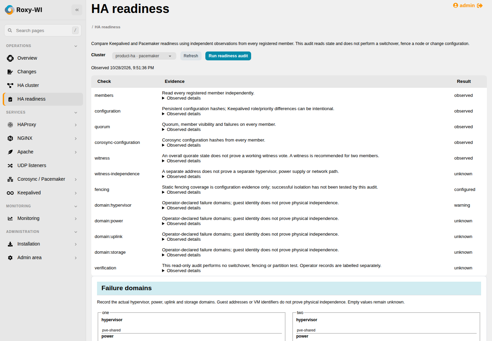

# Shared HA readiness audit

Open **Operations → HA clusters**, choose **Actions → HA readiness** on a
Keepalived or Corosync / Pacemaker card, then select **Run readiness audit**.
The dialog has **Check**, **History** and **Settings** tabs. History belongs to
that cluster; older audits can be loaded without leaving the dialog. Jobs run in
the existing Operations worker and remain in assessment history. A second audit of the same cluster is refused while one is
queued/running. Refreshing or closing the browser does not cancel it.

## Evidence states

| State | Meaning |
| --- | --- |
| observed | This specific current-state read matched the expected condition |
| configured | Configuration describes the capability; no functional test ran |
| declared | An operator supplied failure-domain labels |
| unknown | Required evidence is unavailable or outside this read's scope |
| warning / fail | Review the evidence before relying on HA |
| not-applicable | The selected technology does not provide this mechanism |

There is no general green “HA tested” flag. Quorum does not prove partition
safety, and an installed fencing resource does not prove it can isolate a host.
The audit performs no fencing, resource movement, service action or configuration
write on managed nodes.

## Observations

Pacemaker members must independently expose the expected cluster identity,
readable CIB, crm_mon XML, votequorum state and configured qdevice state. The audit
compares persistent CIB/Corosync hashes, member visibility, quorum and failures.
A working witness requires a positive vote, TLS active and a consistent qnetd
endpoint on **every** member. Missing witness evidence is highlighted for two
members even when two_node keeps the cluster quorate.

Fencing reports the enabled policy and explicit pcmk_host_list/pcmk_host_map
coverage. Static metadata is resolved from global `rsc_defaults` through enclosing
resources to the primitive; a more specific value overrides the inherited value
for that attribute. Effective `target-role=Stopped` or `is-managed=false` excludes
the device from coverage. Dynamic, conditional or unresolved template coverage remains uncertain.
This is not an eligibility simulation or a test of device access, fencing
topology, credentials or actual isolation. CIB secrets, private configuration
text and raw SSH exceptions are not returned to the GUI.

Keepalived checks each configured primary file's hash, process activity and local
IP addresses. Every registered VIP must have exactly one observed owner;
unreachable members prevent this check passing. Role/priority configuration
differences can be intentional. Included files are reported as outside the
primary-file comparison. VRRP has no Pacemaker-style quorum, witness or fencing;
current single ownership does not prove partition safety. Proxy configuration,
external load balancers, network paths and workload capacity need their own checks.

## Failure domains and tests

Administrators can declare hypervisor, power, uplink and storage labels per member
and matched registered witness. Repeated labels flag shared dependencies. Empty
labels remain unknown. A unique guest IP/UUID never proves physical independence.
Edits use revision checks to reject stale forms.

An external planned-switchover, fencing or partition test can be recorded with
its date, passed/failed result, procedure and evidence reference. Entries remain
**operator attestations**, retain actor/date and bind to a completed assessment's
membership, SSH identities and configuration hashes. Drift marks the record as
matching an earlier configuration. It never populates automatically verified-test
evidence. A read-only audit never creates successful failover evidence.

The [HA maintenance wizard](ha-maintenance.md) can record an automatically observed
planned drain and return. Its kind and timestamps are shown separately from
operator attestations. A changed configuration marks the older record stale;
planned maintenance does not establish fencing or network-partition success.

## Access, persistence and API

Cluster service permission and the active group apply throughout. Roles 1–3 may
queue audits; roles 1–2 edit labels and attestations. Reading stored results does
not grant SSH execution. Workers recheck the enabled actor, group role, service
permission and member SSH identities. Membership changes during a read invalidate
the result. Inaccessible hosts remain explicit evidence, not a healthy result.
Reports are encrypted at rest. Migration
`20261028010000_operational_assessments` adds assessment/profile tables.

| Endpoint | Action |
| --- | --- |
| `GET /ha/api/readiness` | List group-owned clusters |
| `GET /ha/api/readiness/PROVIDER/ID` | Profile and recent observations |
| `POST …/run` | Queue an audit |
| `POST …/profile` | Save revision and per-server domains |
| `POST …/attest` | Record an operator's external-test evidence |

PROVIDER is keepalived or pacemaker. Mutations use existing JWT/CSRF authentication.
HTTP 202 means queued; inspect Operations/history for completion.

## Verification

Authenticated API/database and Chromium tests cover zero witness votes despite
quorum, endpoint/TLS mismatch, unavailable members, duplicate VIP ownership,
shared domains, drift, stale revisions, duplicate queues, revoked permissions,
changed SSH identities, group isolation and safe rendering. Screenshots use
synthetic hosts.

On 29 October 2026, real audits completed for Debian 13.7 / Pacemaker 3.0.0 and
Rocky Linux 9.8 / Pacemaker 2.1.10 lab clusters. They observed the actual quorum,
matching member configuration, TLS witness connectivity and nonzero votes, while
lab fencing remained labelled configured and unknown physical failure domains
remained unknown. Completed planned-maintenance evidence was shown separately.
The Keepalived audit also read a separate native Debian/Rocky pair on an isolated
RFC5737 network. It observed both services and exactly one test VIP owner, reported
intentional primary-file differences as a warning and left physical domains
unknown. After independently approved drain/return and verified TLS/HTTP through
the moved VIP, it recorded planned-maintenance evidence separately. This read-only
audit did not itself perform a fencing or partition test.

The combined lab entitlement adapter was used exclusively to qualify PRs
#443–#452; it is external to the repository. Authentication and roles remained
real. These results do not qualify the actual subscription service.

## Evidence identity and upgrades

Per-member configuration hashes, witness observations and VIP-owner evidence use
registered server IDs; display names may repeat. Fingerprints also include a
random identity belonging to the lifetime of the cluster registration. Deleting
and recreating a registration creates a different identity even when SQLite reuses
its numeric ID. Old reports, labels, attestations and queued audits cannot attach
to that replacement. API history and attestation writes check this identity too.

The additive identity migration preserves pre-existing reports/profiles in storage
but leaves evidence without a verifiable registration identity unbound. It cannot
safely infer whether an older numeric ID has already been reused. Such legacy
records are not automatically shown or treated as current: rerun the audit,
re-enter confirmed physical-domain labels and record fresh test attestations.
The identity migration is repeatable and does not regenerate existing identities.

Credential-key rotation reencrypts assessment results in the same transaction as
credentials and queued tasks. An invalid encrypted result aborts the whole
rotation instead of leaving mixed keys. Keep the database and its matching key
backed up together.

Fencing metadata references, rules and templates that this static audit cannot
resolve are classified as uncertain, including inherited and global-default metadata.
Conflicting sets at the same level and legacy `#default` values also remain uncertain;
the audit does not guess scheduler rule/score resolution. Disabled or unmanaged
fencing is excluded. This remains configuration evidence, not proof
that an actual isolation action succeeds.

Background audit polling preserves unsaved failure-domain fields and the revision
on which editing began. Concurrent profile changes return a conflict rather than
silently overwriting another editor. Switching cluster/registration resets the
editing context, and completed saves clear only the edits they actually saved.
