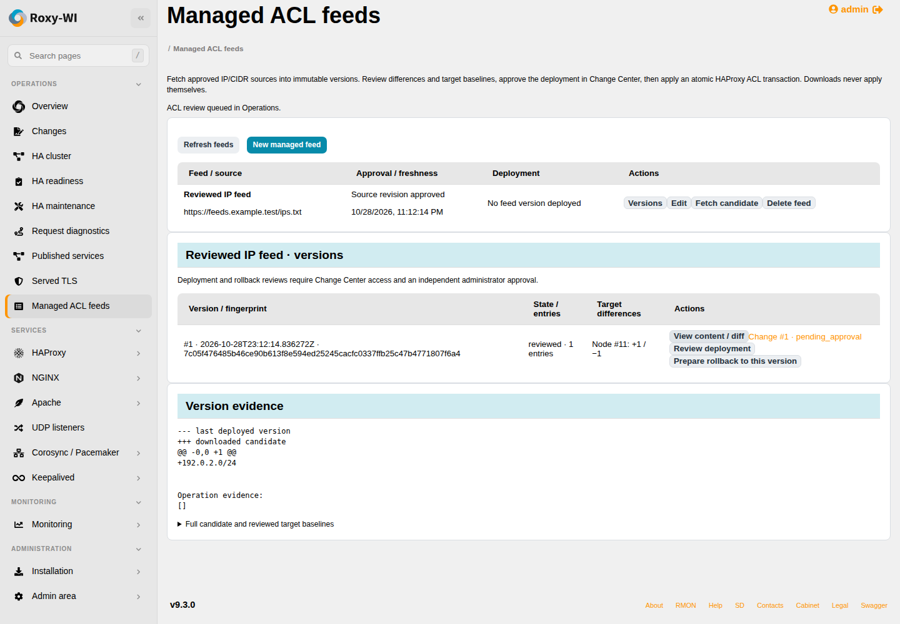

# Managed IP/CIDR ACL feeds

**Operations → Managed ACL feeds** manages approved IP-list sources, immutable
versions, review, deployment and rollback for HAProxy. It is deliberately separate
from certificate providers and keeps source downloading behind a connector
registry (`https-ip-list` initially). Additional formats/providers can supply the
same normalized IP/CIDR contract without changing deployment code.

## Configure a source and discover targets

1. Select **New managed feed**, name it and enter an HTTPS plaintext feed URL.
   Supply a public CA bundle for private PKI. URL credentials, private keys,
   non-HTTPS sources, redirects and compressed responses are rejected.
2. Set maximum entries, broadest permitted prefixes and freshness/download
   intervals. A line contains one IP or CIDR, optionally followed by a `#` comment.
   Duplicates are removed and host bits normalized. Empty, malformed, oversized,
   overly broad and special-purpose inputs cannot replace a production ACL.
3. Select a registered HAProxy node and **Discover IP lists**. Choose a persistent
   named `acl ... src -f /absolute/path` list and **Add target**. Repeat for each
   node (one list per node, up to 32). String ACLs, maps, files outside the managed
   root, symlinks and unpersisted manual Runtime API edits are not eligible.
4. Save, then have an administrator select **Approve source and targets**. Edits
   revoke approval. Private source addressing or prefixes broader than the default
   `/8` IPv4 and `/16` IPv6 limits require a global administrator (role 1).

Existing lists/rules can be prepared through the HAProxy list/configuration GUI;
the feed does not invent application allow/deny rules. The selected file must
already be loaded as an IP `src` ACL. Its persistent directory must be writable
through the saved Docker/Podman mount when containerized.

The downloader resolves DNS once, validates **all** answers and connects only to
a pinned numerical IP while validating the original HTTPS hostname/SNI. Public
sources cannot resolve to private addresses. Explicitly approved private sources
still cannot use loopback, metadata, link-local or multicast endpoints. No proxy
environment, authentication, cookies or redirect forwarding is used. Size/time,
entry-count and prefix limits apply before a candidate version is accepted.

## Download, review, approve, apply

**Fetch candidate** creates a new immutable version only when normalized content
changes. It never deploys. Automatic downloads use the same approval and worker
permission checks; they update the last successful download time. Failed downloads
retain the previous version and expose a fixed error. **STALE** reflects the saved
freshness threshold and successful download timestamp, not merely a scheduled run.

Open **Versions → View content / diff** for the complete candidate, SHA-256 and
reviewed per-node baseline. A displayed diff is bounded to 60000 characters;
the full candidate and all reviewed baselines remain available in the web form
and content API. **Review deployment** reads each target independently and records
its file/runtime/configuration/mount/process identity plus addition/removal counts.
This creates a Change Center operational change requiring an **independent
administrator** approval. Review/deploy/rollback therefore require the existing
Change Center subscription. The author cannot approve their own deployment.

Follow the **Change #...** link and approve there. Return to the feed and select
**Apply approved version**. All targets are prepared before live changes. The
worker preserves file metadata/xattrs, validates the complete HAProxy `-f` tree,
then uses `prepare acl` / `add acl` / `commit acl` to replace each runtime ACL
atomically. It verifies exact normalized runtime contents and process identity.
The persisted file agrees with the runtime result; no service restart is needed.
HAProxy 2.4+ administrative Runtime API is required. Atomicity is **per node**;
multi-node failures trigger compensation, not a claim of one distributed commit.
The [HAProxy transaction reference](https://www.haproxy.com/documentation/haproxy-runtime-api/reference/prepare-acl/)
explains the underlying versioned Runtime API operations.

Targets are exclusively owned by one feed. Do not run separate manual staged ACL
transactions against an owned target. Live manual changes, configuration drift,
changed mounts/SSH identities or a restarted process block a newly reviewed apply.
Pacemaker clusters are locked and handed-over HA maintenance nodes are excluded.
Currently, each selected target must have a running, reachable administrative
Runtime API; passive-only file staging is not reported as a live ACL deployment.

## Failure, recovery and rollback

Requested and verified operations appear in version evidence. The host keeps a
private journal/backup under `.roxywi-acl-feeds/TRANSACTION` in the managed root.
Lost worker/SSH responses can be replayed with the same transaction identity.
Unknown file or live-runtime edits are not overwritten during recovery.

If apply fails, the worker restores every prepared target to its individual
baseline. Failed compensation or interrupted finalization is **recovery-required**:
editing/deleting the feed is blocked. Select **Recover transaction** in the GUI.
Recovery finishes compensation or the already verified commit phase. After a
process restart it may reconcile only a known original/candidate state with the
same configuration and mounts; it never blindly applies a new candidate.
Keep the journal until the operation is resolved. Changes to the original server
identity require inspecting that original host before recovery can be accepted.

**Prepare rollback to this version** clones an older immutable candidate into a
new version, validates it against the current source policy and performs a fresh
per-node review. It needs a new independent approval. This supports rollback
after successful commits without relying on deleted host backups. Deleting a
feed removes management/ownership, not its remote ACL or stored proxy rules.

## Security, API and limits

All records are scoped to the active group and HAProxy service permission. Roles
1–3 may manage permitted feeds; role 4 reads saved versions. Protected servers
require an administrator for changes. Source and independent deployment approvers
must still be enabled and authorized when the worker executes. Queue identities
and reviewed target identities are both rechecked. Source configuration, candidate
contents, reviews and queue payloads are encrypted and included in key rotation.

- `GET/POST /insights/api/acl-feeds`: list/create source definitions.
- `POST /insights/api/acl-feeds/discover`: `{server_id}` → eligible list choices.
- `PUT/DELETE /insights/api/acl-feeds/ID`: revision-checked edit/removal.
- `POST .../ID/approve-source`: `{revision}` → explicit source approval.
- `POST .../ID/fetch`: download only.
- `POST .../ID/review`, `/apply`, `/recover`, `/rollback-version`: `{version_id}`.
- `GET .../ID/versions`: bounded version/status/diff/operation evidence.
- `GET .../ID/versions/VERSION/content`: complete candidate and reviewed baselines.

At most 256 feeds/group, 32 nodes/feed, 100000 entries and 2 MiB input/normalized
content are accepted. Combined inspected ACL contents are bounded to 4 MiB/host;
the encrypted multi-node review must fit its 2 MiB plaintext limit. Reduce target
count/feed size when a review exceeds that bound. Version history displays the
latest 50 entries, plus an explicitly linked older Change Center version.
Oversized evidence fails explicitly. Downloads and changes
run through Operations; the UI supplies discovery, source policy, approval links,
full content, version selection and recovery without requiring an SSH terminal.

## Verification

Database/API tests cover source approval/revocation, download-only behavior,
independent Change Center approval, immutable versions, duplicate ownership,
identity/role/tenant boundaries, two-node compensation, interrupted-worker replay,
recovery locks and newly reviewed rollback. Real local HTTPS verifies pinned DNS,
SNI/private-CA trust and absence of authentication/cookies. Real isolated HAProxy
tests change HTTP behavior, persist/restore ACLs and metadata, recover lost writes,
reject configuration drift and execute the exact framed helper outside an app
installation. Chromium covers discovery, approval, versions, content and apply.
On 29 October 2026, a real private HTTPS feed was independently approved and
deployed through Change Center to Debian 13.7 and Rocky Linux 9.8 HAProxy/Podman
hosts, with Rocky SELinux enforcing. A baseline returned HTTP 200 on both. A newly
approved version containing the probe address changed both to HTTP 403; rollback
created a new immutable version requiring a new independent approval and restored
HTTP 200 on both. A subsequent malformed feed failed without replacing that
deployed version or changing the working HTTP response. Actual Runtime and
persistent-file state were checked. The lab used deliberately disposable rules.

The external entitlement adapter was used exclusively for testing PRs #443–#452;
authentication, source authorization and independent approvals remained real.
It is absent from the commits and does not qualify the real subscription service.
