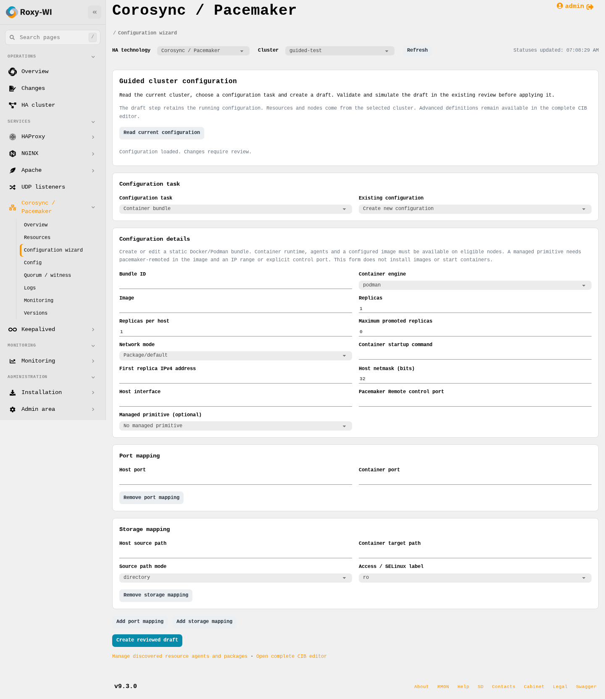
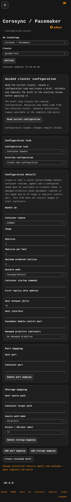

# Guided Pacemaker configuration

Open **Services → Corosync / Pacemaker → Configuration wizard**, select a cluster
and click **Read current configuration**. The wizard reads current resource IDs,
registered node names, static definitions and attribute names. No cluster command
is applied by loading or submitting a form.

1. Select a configuration task.
2. Create a new definition or select an existing supported definition. Use the
   fields and ordered rows; no XML or JSON is required for these profiles.
3. Click **Create reviewed draft**. The existing configuration page shows the
   previous/candidate CIB. **Validate and simulate** must succeed before **Apply
   reviewed change** becomes available. Review the scheduler output and confirm
   the application through the existing cluster operation workflow.

Saving is bound to the original CIB digest, checked both before building and again
under the existing cluster lock before persistence. Changes made by another
administrator invalidate the loaded form. The wizard does not merge stale
snapshots, install packages/images, start containers or execute a fencing test.

## Supported tasks

| Task | Fields and behavior |
| --- | --- |
| Fencing topology | Select a registered target and ordered levels 1–9. Each level contains an ordered list of existing fencing devices. All devices in a level must succeed; the next level is the fallback. Other targets are retained. Removing every level clears only that target's explicit topology. |
| Location and time rules | Select a resource, score, AND/OR combination, node-attribute comparisons and explicit date windows. Dates are entered with a calendar in the browser's timezone and serialized with an explicit UTC offset. Existing supported location rules can be edited; unrelated constraints are preserved. |
| Groups and clones | Select existing standalone resources, order group members, or wrap one primitive/group as a clone or promotable clone. Configure static resource/clone meta-attributes. Unselected current members are retained as standalone resources, which can change placement: review simulation. |
| Resource operations | Select an existing primitive and an existing/new monitor or lifecycle operation. Read installed-agent timing recommendations, choose interval, timeout, role, failure policy and enabled state, or create a removal draft. The agent must advertise the selected action. Existing operation IDs and unrelated settings are retained. |
| Container bundles | Select Docker/Podman, image, replica limits, network, optional IPv4 range/interface/netmask, Remote control port, port mappings and directory storage mappings. Optionally move an existing standalone primitive into a new bundle. Editing retains its existing embedded primitive and unrelated metadata. |
| Resource meta-attributes | Edit supported static overrides such as stickiness, migration threshold, failure timeout, priority, desired role and management state. Empty values clear explicit overrides; unrelated keys remain present. |

A bundle image must already contain the required workload. A bundle with a
managed primitive also requires Pacemaker Remote inside its image and a reachable
replica IP range or explicit control port. Host networking permits one replica per
host. The appropriate runtime and resource agents must be installed on eligible
nodes; the wizard checks common agent metadata and native CIB validation, and does
not invent an application deployment. Use existing Installation/agent-package
controls where supported. The Remote control port is mapped automatically and
must not be repeated in the explicit port mappings.

Bundle storage paths, image names, application capacity and intended failure
policies are operator decisions. Selecting a host directory or a SELinux relabel
option can affect the application when the separately reviewed candidate is
applied. The draft step itself does not access or relabel those directories.

## Shared interface and refresh

The wizard uses the current Pacemaker workspace panels, shared `rw-*` controls,
existing select widgets and the same field grids as the other cluster pages.
Nested fencing levels, conditions, metadata and bundle mappings each have a
panel heading with their own field grid. All six tasks support narrow screens
and the existing dark theme; no separate wizard stylesheet is added.

Reading configuration disables duplicate requests while retaining the visible
form and its geometry. A failed refresh leaves unsaved values available and the
read action enabled for retry. A successful read rebuilds the form from the new
cluster snapshot. Selecting another cluster discards the old snapshot and
ignores late replies from that cluster. These interface actions do not apply a
CIB or enqueue a managed-host operation.

## Preserving adopted and custom configurations

The forms edit supported definitions, not a regenerated whole cluster. Other
resources, agent parameters, status, properties and unrelated constraints are
retained. Existing IDs are reused where the corresponding rule/operation remains.
Resources cannot be taken from another group's/clone's/bundle's ownership by
selecting them as if they were standalone.

The page identifies definitions retained in the complete CIB editor. These include
nested rules, conditional/referenced meta-attribute sets, advanced bundle command
options, unsupported mappings and pattern/attribute-selected fencing topologies.
Those definitions are never silently flattened or stripped to fit a form. Legacy
or newer schema-specific features remain available through the existing lossless
editor and the managed hosts' native validation.

## API and access

- `GET /pacemaker/api/CLUSTER/guided` returns the bounded, group-scoped form catalog
  and original digest. Operator permission is required, including for reads.
- `POST /pacemaker/api/CLUSTER/guided` accepts `base_digest`, a typed `kind` and its
  form `data`; it creates the existing encrypted `PacemakerChange` draft only.
- Existing JWT/CSRF, service access, group boundaries, validation, simulation,
  operation ownership and application confirmation remain in force. No database
  migration is required.

## Verification

`tests/unit/pacemaker/test_guided_editor.py` checks ownership, IDs, ordered fallback,
Boolean aliases, XML escaping, timezones, unknown-definition preservation,
resource retention, stale snapshots and supported candidates through the real
`crm_verify` when installed. Product API tests use real authentication, encrypted
drafts and database locks with deterministic SSH observations. Chromium exercises
all six tasks, existing operation edits, light/dark panel and field layout,
refresh stability, duplicate requests and error/retry with unsaved values. These tests do
not replace the final live Debian/EL qualification, including fencing-device
metadata, native simulation and workload behavior. That qualification is recorded
separately before the draft PR is marked ready.

The opt-in `tests/integration/test_pacemaker_guided_live.py` suite creates each of
the six draft types through HTTP and invokes the managed hosts' actual native
validation and simulation. All six cases passed on both Debian 13.7 / Pacemaker
3.0.0 and Rocky Linux 9.8 / Pacemaker 2.1.10 on 29 October 2026. It also checked
that the live CIB digest remained unchanged and both clusters stayed healthy.
With the separate apply opt-in, all six candidates were then validated, applied
through the real Operations worker and restored through newly reviewed restore
drafts on both clusters. The Podman bundle ran an Alpine 3.21 sleep workload;
the test observed its active resource, then its removal after restore. Every
original configuration digest was recovered and both clusters remained healthy.
The combined run passed all 12 cases in 241 seconds. Topology editing did not
invoke a physical fencing action. This does not qualify arbitrary application
images, every storage/network mapping or workload-specific promotion behavior.

To reproduce on disposable, registered lab clusters, prepare the private JSON
configuration described in [the cluster testing guide](corosync-pacemaker-testing.md),
with mode 0600 and a standalone lab Dummy plus an existing fencing device in
each cluster. Then explicitly opt in:

```sh
ROXYWI_PACEMAKER_GUIDED_LIVE=1 \
ROXYWI_PACEMAKER_GUIDED_CONFIG=/private/path/lab.json \
python3 -m pytest tests/integration/test_pacemaker_guided_live.py -q --no-cov
```

By default the suite never applies drafts or invokes a fencing action. To also
apply and restore them on disposable clusters, add
`ROXYWI_PACEMAKER_GUIDED_APPLY_LIVE=1`. Podman and access to the Alpine image must
be available on eligible members. This second mode briefly moves the lab Dummy
and starts a temporary bundle. It keeps a mode-0600 recovery CIB only beside the
private lab configuration, outside the checkout; CIBs can contain fencing
credentials. It restores through the normal reviewed API and refuses to overwrite
an unexpected concurrent change. If recovery cannot be verified, the private
recovery file remains for manual inspection. Ordinary CI skips the suite because
it requires those real lab clusters and credentials.

The implementation follows the native [collective resource](https://clusterlabs.org/projects/pacemaker/doc/2.1/Pacemaker_Explained/html/collective.html),
[rule](https://clusterlabs.org/projects/pacemaker/doc/2.1/Pacemaker_Explained/html/rules.html)
and [fencing topology](https://clusterlabs.org/projects/pacemaker/doc/2.1/Pacemaker_Explained/html/fencing.html)
semantics. The target's installed schema and tools remain authoritative.




