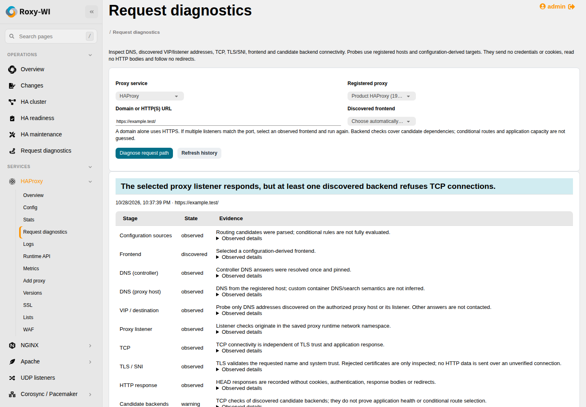

# Request-path diagnostics

Open **Operations → Request diagnostics** or **Request diagnostics** in a proxy's
service submenu. Choose an enabled registered HAProxy, NGINX or Apache server,
enter a domain/HTTP(S) URL and run the assessment. A domain alone uses HTTPS.
Results and history remain in the existing Operations queue after the browser
closes. If multiple frontends match the port, select one of the discovered
frontends and run again; an ambiguous route is not guessed.

## What is checked

| Stage | Evidence |
| --- | --- |
| Configuration sources | Configuration-derived frontend and candidate-backend metadata, source hash and completeness |
| DNS | Answers from the controller and the registered host, including differences |
| VIP / destination | Only DNS addresses matching the selected frontend's bindings are contacted; unmatched DNS evidence remains separate |
| TCP | Connection result, address, port and connect time |
| TLS / SNI | Requested hostname, system trust, certificate fingerprint/expiry/issuer and protocol |
| HTTP | One HTTP/1.x HEAD status; no credentials, cookies, response bodies or redirects |
| Candidate backends | TCP checks from the saved proxy network context to configuration-derived endpoints |

A result can explain that a listener responds while a discovered backend refuses
TCP. This identifies evidence, not necessarily the selected application's complete
cause: ACLs, maps, Lua, regex routes, third-party modules and application behavior
are not fully evaluated. An HTTP response does not prove the application healthy.

## Configuration and runtime scope

HAProxy source discovery reads its configured startup files. NGINX uses its native
configuration dump and expands included files back into their original contexts.
Apache uses its own DUMP_INCLUDES list, including files inside a selected container,
then preserves virtual-host include context. Dynamic/conditional constructs are
explicitly partial. Configuration text, passwords and certificate keys are never
included in the report.

HAProxy `listen` sections retain their own servers and static `use_backend` /
`default_backend` dependencies. Dynamic backend expressions and undefined backend
references remain unresolved routes: they mark inventory partial and increase
the report's unprobed count, even when a static default backend was reached.
That count includes unresolved route directives; it does not estimate how many
servers a dynamic expression could select. Expressions themselves are not exported.

An explicit listener IP matches only that address and port. Wildcards match the
registered host's interface addresses: HAProxy's omitted address, `*` and
`0.0.0.0` are IPv4 wildcards; `::` is IPv6. An explicit `v4v6` flag also permits IPv4 for the IPv6 wildcard; unknown
system dual-stack defaults are not guessed. A response from another frontend's
address cannot establish the selected listener's health.

These are configuration candidates. On-disk content can differ from what a running
process previously loaded. NGINX/Apache inspection uses the service's configured
main path and does not claim to discover every custom startup wrapper/prefix.
The source hash is rechecked after probing; concurrent configuration changes mark
the assessment stale. Actual listener connections are separate observations.

Saved Docker/Podman engine, Linux owner and container name apply. Container probes
enter a verified, pinned network namespace rather than guessing a bridge address.
Backend names resolve from the managed **host**; custom container DNS/search rules
are not inferred. Each TLS probe uses its host system CA store, not the container
filesystem's CA store. Unverifiable namespaces or unsupported Unix/dynamic targets
remain explicit unknown/unprobed evidence.

## Safety and limits

The URL cannot supply credentials, a fragment, a non-HTTP scheme or request-header
control characters. Targets and ports come from current authorized configuration;
the form cannot submit arbitrary backend addresses. DNS is resolved once and
numerical addresses are pinned before connection. Link-local, multicast,
unspecified and known metadata endpoints are refused; controller loopback is not
treated as a remote VIP. Redirects, proxy environment variables, response bodies,
cookies and authorization headers are not used.

A rejected TLS certificate is observed through a separate read-only handshake,
labelled untrusted; no HTTP request crosses that unverified connection. It is
never converted into a verified success.

Reads are bounded: 2 MiB configuration, 128 source files/frontends, 16 candidate
backends per assessment and four resolved addresses per backend. Omitted targets
are counted. Checks use short socket/DNS deadlines. This is an on-demand
diagnostic, not an unrestricted scanner or an application load test.

The active group, enabled server, service permission and operator role apply
before queuing and again in the worker. SSH/runtime identity changes invalidate a
queued assessment. Reports are encrypted at rest and included in secret-key
rotation. Stored results may be viewed only through the current group/service
authorization and the same immutable server registration identity. Deleting and
recreating a server generates a new identity even if its numeric ID and IP are
reused. History, individual reports and queued work cannot cross that boundary.

The registration migration adds server identities and binds new proxy assessments
to them. Existing reports are retained encrypted but remain unbound: matching an
ID, IP or old task payload is insufficient proof of their registration. They are
not exposed as current history; run a fresh assessment instead. Legacy queued
assessments without this identity fail before probing and must be resubmitted.
Upgrade web and worker processes together before running new diagnostics.

## API and verification

| Endpoint | Action |
| --- | --- |
| `GET /insights/api/choices` | Group/service-scoped registered proxies |
| `POST /insights/api/diagnostics` | Queue service/server_id/url/optional frontend_id |
| `GET /insights/api/diagnostics?service=SERVICE&server_id=ID` | Recent assessments |
| `GET /insights/api/assessments/ID` | Group-scoped operation/report |

Authenticated API/browser tests cover refused backends, wrong TLS, configuration
drift, unregistered DNS destinations, invalid URLs, group/role/runtime changes,
duplicate jobs and mobile layout. Real local HTTP/TLS tests verify SNI/private CA,
untrusted handshakes, no redirect/auth/cookie behavior and blocked addresses.
Include-context regressions cover NGINX and Apache. Screenshots use synthetic
registered hosts.

On 29 October 2026, real HAProxy paths on Debian 13.7 / Podman 5.4.2 and Rocky
Linux 9.8 / Podman 5.8.2 (SELinux enforcing) returned HTTP 200 for HTTP and verified
HTTPS, including the discovered backend probe. Stopping only the disposable
backend produced a connected proxy listener, refused backend TCP and HTTP 503;
the report identified the backend refusal. The backends were restored.
The untrusted private-root case was also rejected. The positive trust case used
temporary public lab CA anchors on the controller and probe hosts; all those
anchors were removed afterward. No TLS verification was disabled.
These results qualify the described HAProxy paths; other application routing and
proxy-specific include combinations retain their separate automated coverage.
