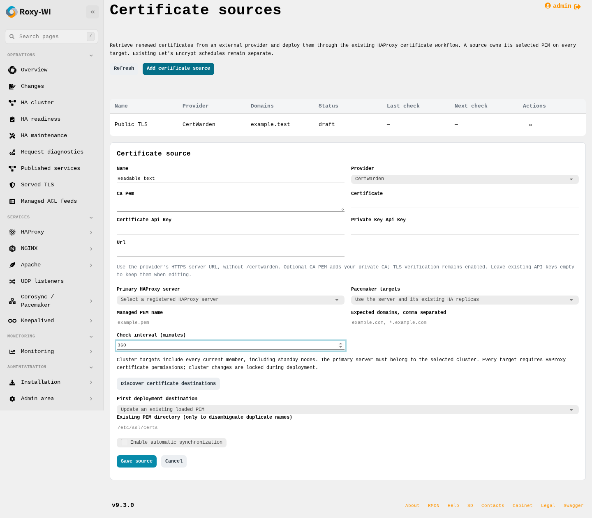
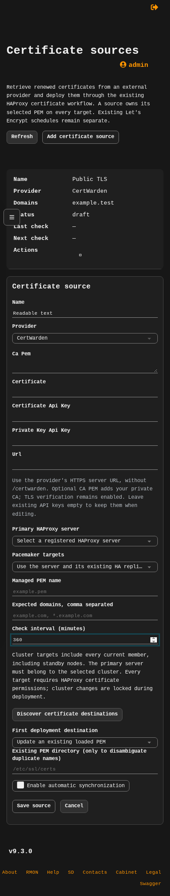

# Certificate sources example

Captured from the automated authenticated product workflow with a controlled
provider and synthetic managed host. This is an example of the shared Roxy-WI
table/actions UI, not evidence of live CertWarden or Debian/EL VM qualification.
All names are synthetic and no API keys or certificate private keys are shown.
