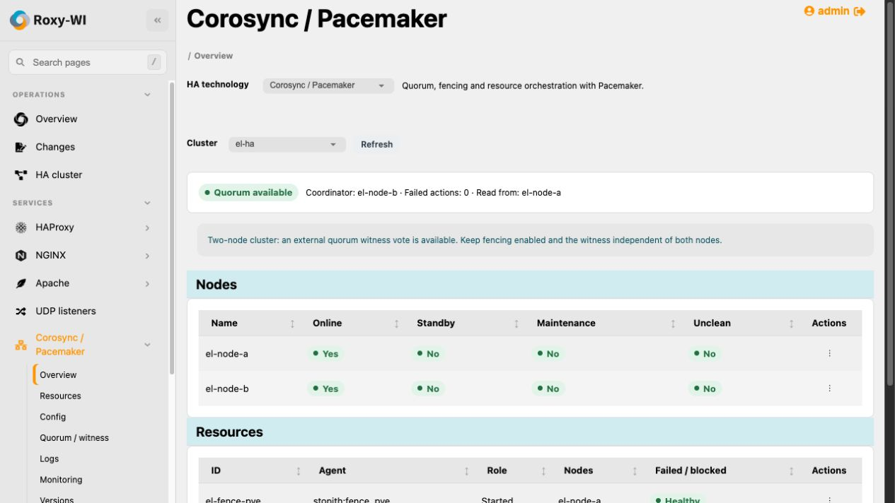
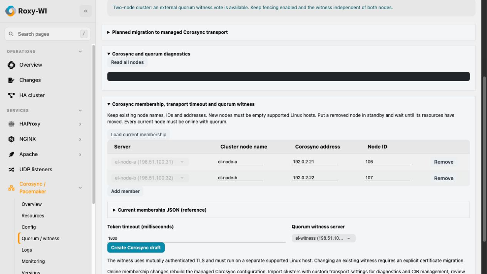
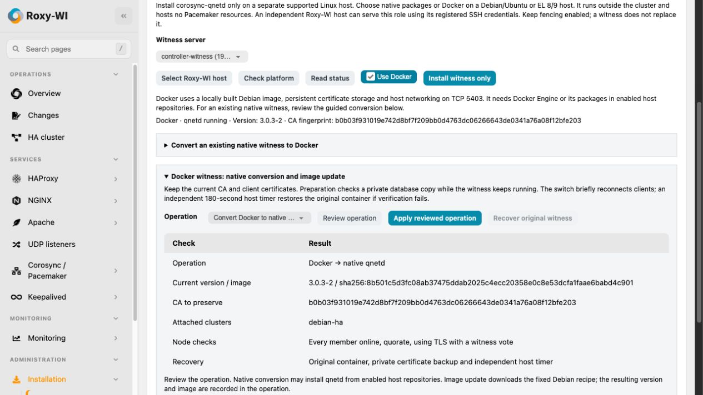
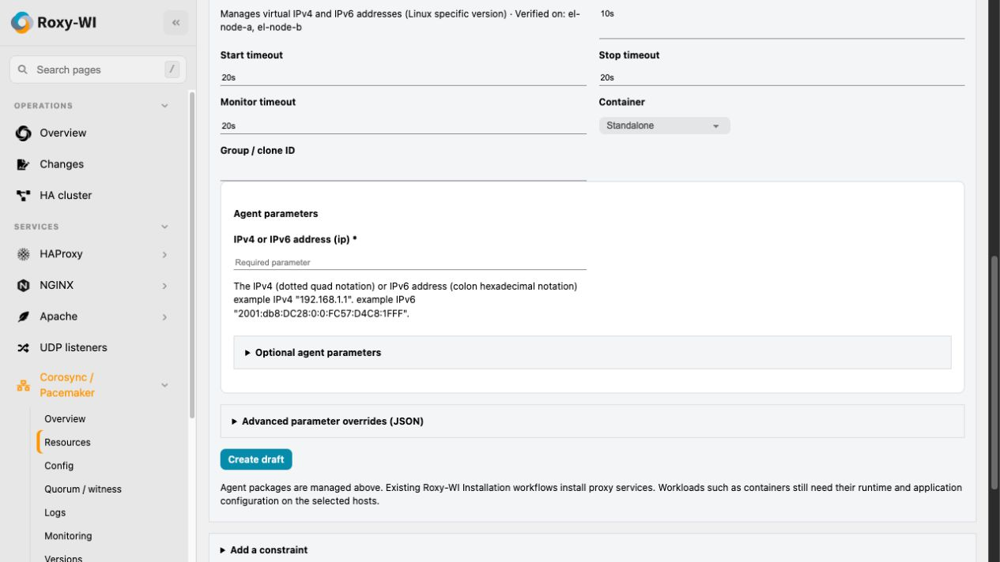
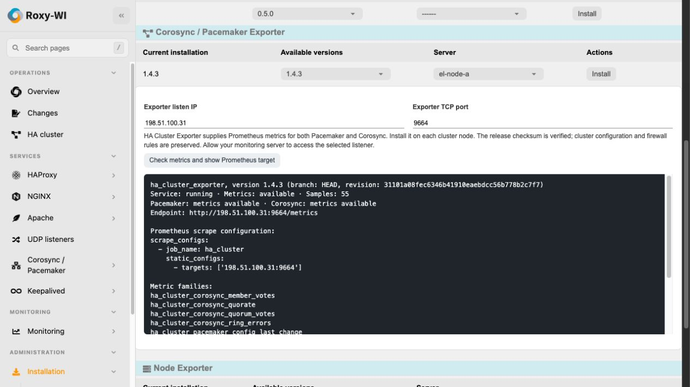

# Corosync/Pacemaker interface

Captured from the running disposable Debian/Rocky lab on 2026-10-27 using the
standard Roxy-WI interface. A read-only presentation proxy replaced private
management addresses, host/cluster names and certificate fingerprints with
example values before rendering. Discovery and status responses came from the
real hosts; the screenshots do not change the actual cluster configuration.
Addresses use documentation ranges. No CIB XML or credentials are shown.

## Cluster overview

## Membership and independent witness

## Reviewed witness lifecycle

## Discovery-driven agent parameters

## Exporter and Prometheus target

