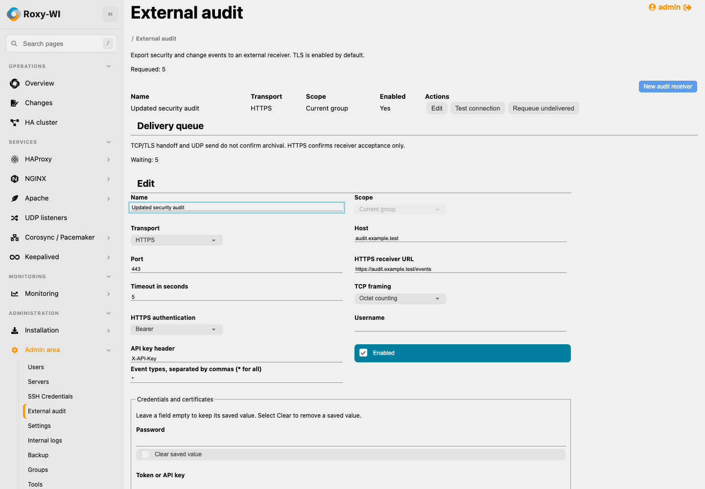
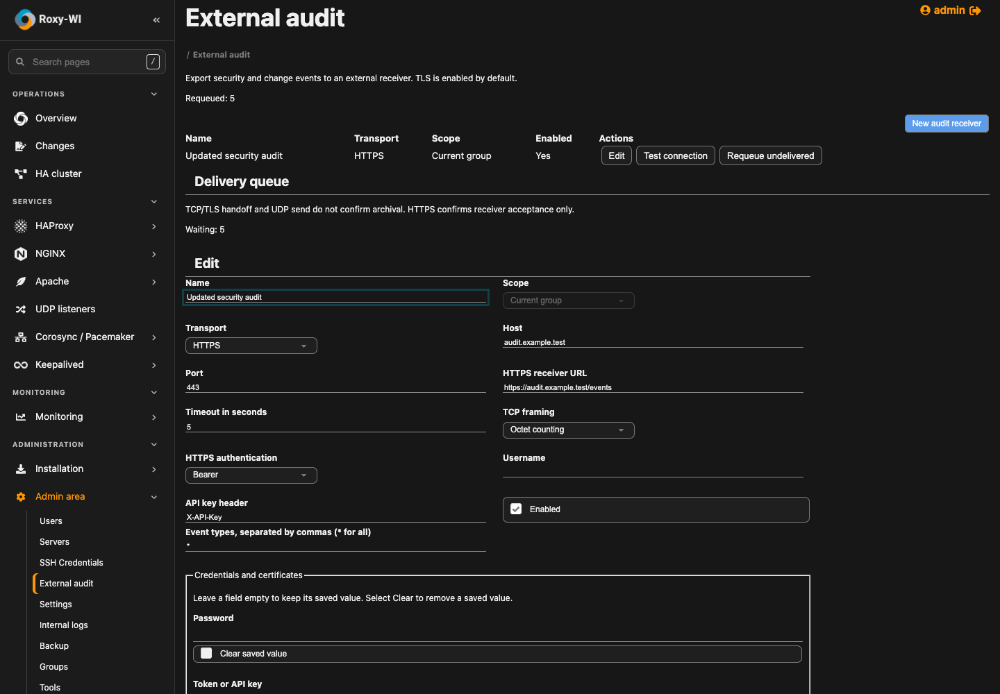

# External audit UI

Captured from the local real application/product fixture in Chrome. All identities,
servers and receiver settings are synthetic; stored credential fields are blank.
The browser scenario replaces the connection-check transport only. Real network
framing/TLS/authentication are covered separately by loopback integration tests.
These images do not claim Proxmox, production or SELinux verification.
