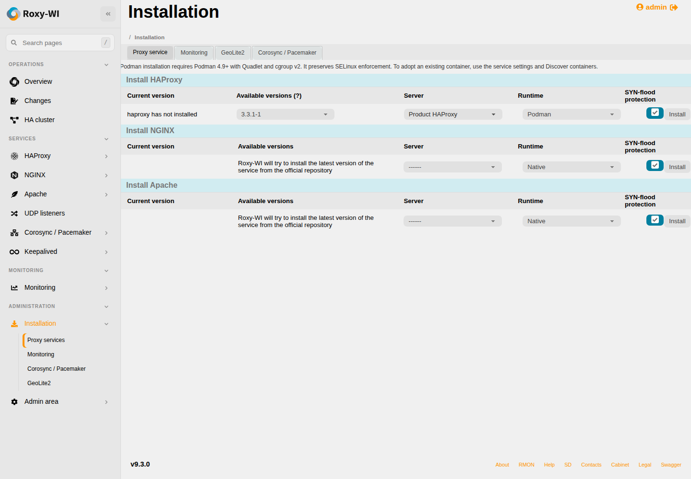
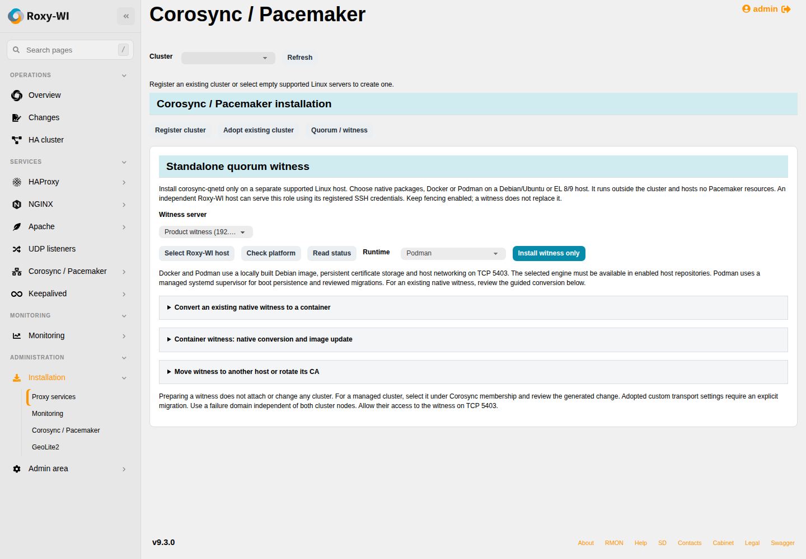

# Managed container examples

Captured from authenticated automated Chromium product workflows with synthetic
registered hosts. The forms use the existing Roxy-WI controls and styles. These
images illustrate the GUI; they do not establish Debian/EL VM qualification.
No credentials or private keys are shown.
