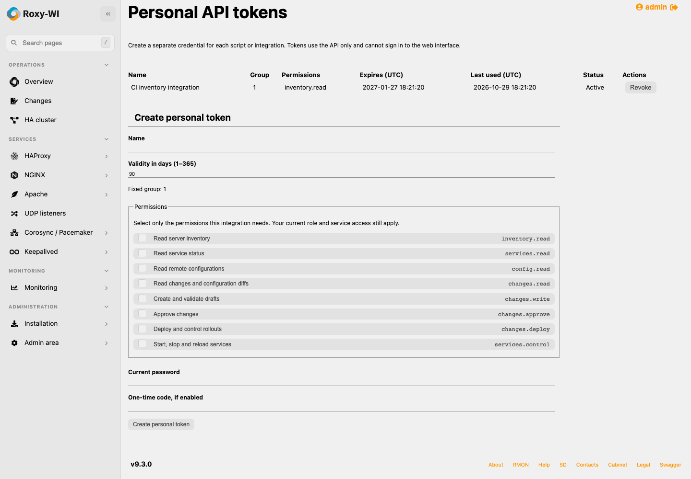
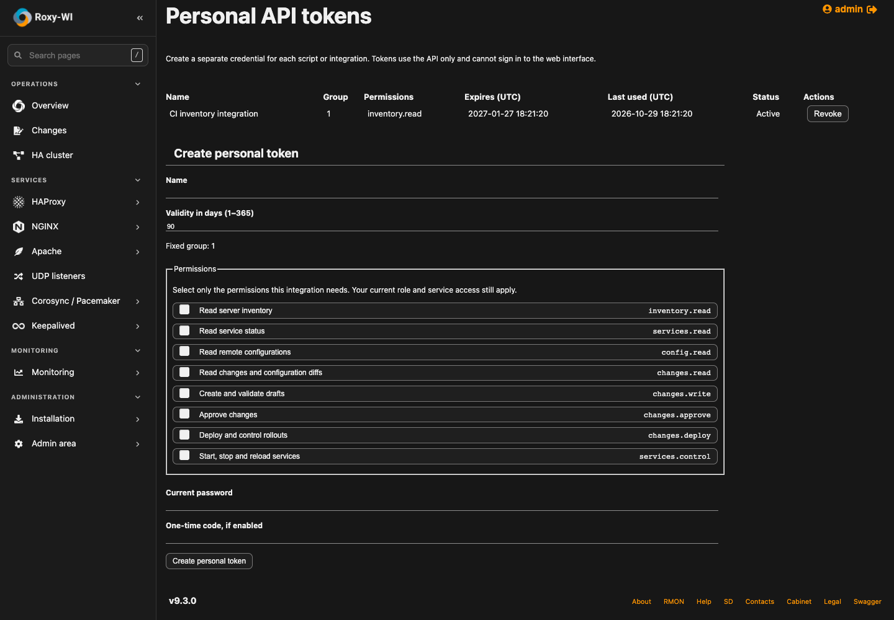

# Personal API token UI

Captured in local Chrome from the real application/product fixture. All accounts,
servers and integration names are synthetic. The token is actually created and
used against the API, then hidden before either screenshot is captured. No real
credential appears in these images. They do not establish Proxmox or EL/SELinux
qualification; those checks follow draft publication.
