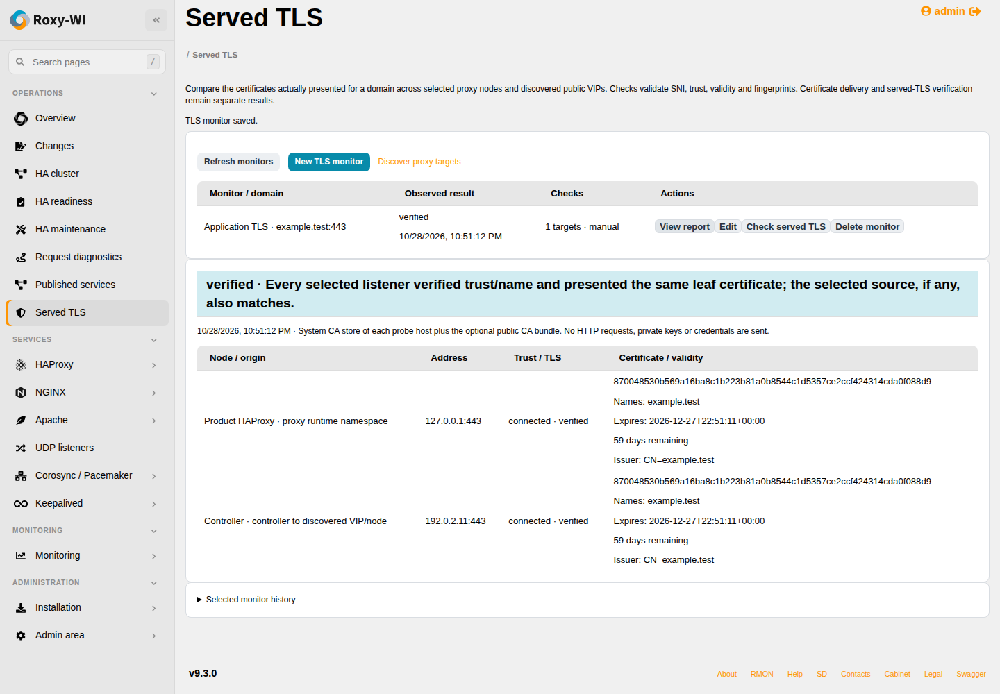
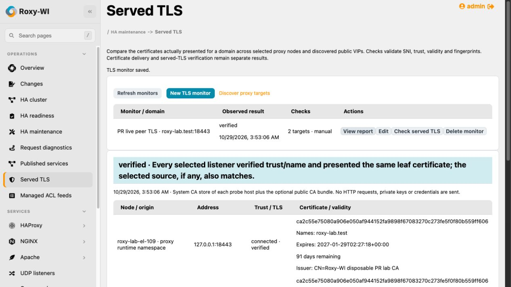

# Served TLS across proxy nodes

**Operations → Served TLS** verifies the certificate clients can receive, rather
than assuming that a PEM file or successful provider upload is live evidence.
It supports HAProxy, NGINX and Apache, including the saved Docker/Podman owner
and network namespace. It never starts, reloads or relocates a proxy resource.

1. Discover each proxy in [Published services](published-services.md). The domain
   must be discovered or explicitly confirmed on its frontend.
2. Select **New TLS monitor**, the domain and a discovered TLS port. Select all
   relevant node frontends (up to 32), including both HA members when appropriate.
3. Optionally select an expected **Certificate source** such as CertWarden.
   Without a source, the check compares peers without asserting provider delivery.
4. For private PKI, supply the **public CA bundle**. Private keys are rejected.
   Each probe otherwise uses its host's system trust store; a container image's
   separate filesystem trust store is not inferred.
5. Save and select **Check served TLS**. Open **View report** for per-endpoint
   fingerprints, SANs, issuer, validity, TCP and TLS/name-validation results.

The worker connects to numerically pinned addresses. It supplies the requested
domain as SNI and validates the chain and hostname. It sends no HTTP requests,
cookies or credentials. For rejected chains, a separate handshake may read the
leaf certificate for diagnosis; this never turns failed trust into success.
Only public certificate metadata is stored; private keys never enter this path.

## What the result means

- **verified**: all selected listeners were checked, trust/name validation
  succeeded, their leaf fingerprints agree, the optional current provider
  fingerprint agrees, and DNS has no unmatched destinations.
- **mismatch**: observed endpoints disagree, or the expected provider certificate
  is absent/not current/different. A completed provider upload is not TLS proof.
- **partial**: an endpoint was unreachable, trust/name validation failed,
  discovery/DNS failed, or a DNS destination was outside the discovered scope.
  A passive Pacemaker node with no listener is incomplete, not falsely verified.
- **expiring**: the checks otherwise pass, but validity is below the configured
  warning threshold. TLS validation also rejects expired/not-yet-valid chains.
- **stale**: proxy configuration changed from the reviewed target snapshot.
  Rediscover and edit the monitor before relying on a new check.

Direct member checks run in each selected proxy's network namespace, so published
host port translations are not substituted for its internal listener. Up to four
matching listeners per selected frontend are checked; additional listeners make
the result incomplete. Controller checks cover up to eight DNS answers matching
current selected-node interface addresses or literal configured listener IPs.
Unmatched answers are displayed and never contacted. Special/metadata addresses
are rejected by the shared probe helper. See [probe boundaries](proxy-diagnostics.md).

Configuration hashes and proxy identities are rechecked. Certificate-source
changes during a run fail it, requiring a fresh run against one expectation.
Reports include times and revision; historical verification is not continuous
monitoring. The publication map shows matching per-domain/node TLS evidence and
flags an expected source that changed after the report.

## Recurring and post-renewal checks

Enable **Run periodically and after a selected certificate source deploys a new
fingerprint**. The scheduler uses the durable Operations queue at the selected
interval (5–10080 minutes). A new *current* source fingerprint triggers an earlier
check on the next scheduler pass, after deployment. A completed chain-only bundle
replacement also triggers a check even if its leaf certificate is unchanged.
The new result can still be
`mismatch` or `partial`: source synchronization and live verification have separate
histories and success criteria. Duplicate jobs are blocked.

The monitor executes as its saved user; permission, group, enabled proxy,
credential and container-binding changes are checked again by the worker. Roles
1–3 can create/edit/run/delete permitted monitors; role 4 reads saved evidence.
Changes use optimistic revisions and cannot edit/delete an active check. Monitor
configuration, reports and queue payloads use the credential encryption key and
are included in its atomic rotation. Delete removes the monitor, not a provider,
certificate or remote proxy configuration. Reports remain in internal history.

## HTTP API

- `GET/POST /insights/api/tls`: list monitors/source choices or create a monitor.
- `PUT/DELETE /insights/api/tls/ID`: revision-checked edit or deletion.
- `POST /insights/api/tls/ID/run`: queue a check; returns assessment/task IDs.
- `GET /insights/api/tls/ID/history`: bounded run history including task state.

Create/edit fields: `name`, `domain`, `port`, `targets` (array of service-map
`assessment_id`/`frontend_id`), optional `source_id`, `ca_pem`, `warning_days`,
`interval_minutes`, `enabled`, and `revision` for updates. Targets and domain must
come from the latest successful discovery/confirmation at save time. There are
at most 256 monitors per group. The GUI supplies these fields and source/target
choices; no shell setup is required beyond normal SSH/runtime prerequisites.

## Verification scope

Database/API/worker tests cover matching and old peer certificates, provider
expectation, renewal-triggered queueing, partial/untrusted/expiry results,
configuration drift, duplicate jobs, revisions, tenant/role boundaries and
private-key rejection. Real disposable TLS servers verify trusted chains with
different leaf certificates and that no HTTP is sent. Chromium covers the native
monitor form, discovered-target selection, report and mobile overflow.

On 29 October 2026, a real CertWarden-driven renewal was deployed to HAProxy on
Debian 13.7 / Podman 5.4.2 and Rocky Linux 9.8 / Podman 5.8.2 with SELinux enforcing.
The real GUI selected both current discovered frontends and launched the check.
Its report verified four controller/managed-host endpoints, consistent peers and
the expected provider SHA-256 fingerprint. The browser polled automatically to
the terminal report. An earlier private-CA chain missing strict X.509 extensions
correctly produced partial evidence; the fixture was corrected without relaxing
verification. This is manual-run evidence, not a production renewal schedule test.

